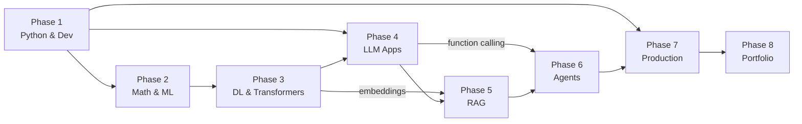
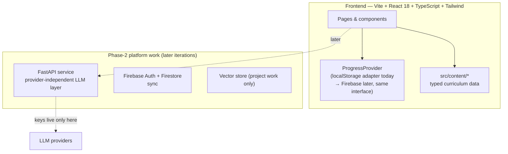

# AI Agent Engineer Platform — Analysis & Implementation Report

**Prepared for:** MSc Computer Science graduate with React/web development experience, basic Python, and two prior ML projects (Netflix recommendation, social-media sentiment analysis).
**Goal:** Design and build an interactive learning platform that takes you from your current skills to a production-capable AI Agent Engineer.
**Date:** 2026-10-21

---

## 1. Your likely starting point & what to assess first

**Established strengths**

| Area | Evidence | Implication |
|---|---|---|
| Web engineering | HTML/CSS/JS/React | You can build UIs, understand HTTP/JSON, state, and component architecture — Phase 7 (deployment, APIs) will feel familiar |
| CS fundamentals | MSc in Computer Science | Algorithms, complexity, databases concepts — you can handle rigorous material when presented clearly |
| ML exposure | 2 applied projects | You know the shape of an ML pipeline: data → features → model → evaluation |
| Motivation alignment | Explicit interest in LLMs, RAG, agents | Sustained-study risk is lower; the platform should feed that interest early (LLM APIs in Phase 4 are reachable within weeks) |

**Likely gaps — hypotheses the platform must verify, not assume**

1. **Python depth** — beyond scripts: packaging, virtual environments, idiomatic OOP, `asyncio`, error handling. (You said this yourself.)
2. **Math retention** — linear algebra/probability learned years ago decays; needs a refresh tuned to ML use, not a full re-derivation.
3. **ML rigour** — common self-taught gaps: leakage, proper cross-validation, metric selection for imbalanced data. Your sentiment project likely used a single train/test split.
4. **Deep learning & transformers** — probably used Keras/sklearn-level APIs; backprop intuition, PyTorch, and attention internals are likely new.
5. **LLM application patterns** — structured outputs, function calling, streaming, retries, cost engineering.
6. **Agentic architectures** — agent loops, planning, memory, multi-agent, MCP.
7. **Production AI** — Docker, observability, evaluation harnesses, prompt-injection defence.

The platform therefore **starts with a 15-question diagnostic** across five domains (Python & software, math & statistics, classical ML, deep learning & NLP, LLMs & agents). Results do three things: (a) recommend a starting phase, (b) optionally *credit* prior-knowledge modules — only with your explicit confirmation, never automatically inflated — and (c) mark "revision" areas to revisit later.

---

## 2. The full learning roadmap (8 phases · 44 modules · ≈730 guided hours)

Your 16 requested stages map to 8 phases (adjacent stages merged where they're learned together):

| Phase | Title | Modules | Hours | Outcome (you can…) |
|---|---|---|---|---|
| 1 | Python & Developer Foundations | 7 | 94 | ship a tested, packaged Python app that consumes an API |
| 2 | Mathematics & Machine Learning | 7 | 96 | train & evaluate models you can defend in an interview |
| 3 | Deep Learning & Transformers | 7 | 92 | build small networks; read transformer code without fear |
| 4 | LLM Application Engineering | 7 | 70 | build a tool-using assistant with validated outputs |
| 5 | RAG & Knowledge Systems | 7 | 72 | ship a cited document-Q&A app with measured retrieval quality |
| 6 | AI Agents & Agentic Workflows | 11 | 138 | build multi-step agents with memory, tools & human approval |
| 7 | Production AI Engineering | 10 | 120 | deploy a secure, monitored, evaluated agent service |
| 8 | Portfolio & Career | 4 | 50 | present 3–5 deep projects and pass role interviews |

**Module-level detail** lives in the app itself (`src/content/modules.ts`), each with objectives, prerequisites, hours, difficulty, essential/optional flag, completion criteria, and a portfolio deliverable. Four modules are flagged **optional specialisations**: experiment tracking (P2), fine-tuning (P3), multi-agent systems (P6), advanced CI/CD (P7). Everything else on the essential track is required for the target role.

---

## 3. Dependency map

Phases progress strictly left-to-right, with these **cross-phase edges** that matter most:

Key module-level dependencies the graph enforces:

- **Async/HTTP (P1) → LLM APIs (P4)** — you can't build agent infrastructure without understanding concurrent network calls.
- **Embeddings (P3) → Vector search & RAG (P5)** — retrieval quality is an embeddings problem before it is a prompt problem.
- **Function calling (P4) → Agent loop (P6)** — tools are the agent's hands.
- **RAG project (P5) + LangGraph (P6) → Production capstone (P7)**.

**Gating policy (deliberate):** the roadmap *recommends* order but never blocks exploration. Locked modules are visually dashed/dimmed with their missing prerequisites named; opening them is always allowed with a "prerequisites not met" banner. Learning is yours to direct — the graph just encodes the efficient path.

---

## 4. Timeline estimates

Honest arithmetic, including project time, based on the curriculum's hour data. **These are estimates** — actual pace varies with prior knowledge, retention, and life.

| Track | Total hours | @ 5 h/week | @ 10 h/week | @ 15 h/week |
|---|---|---|---|---|
| Full track (all 44 modules) | ≈ 732 | ≈ 146 weeks (~2.8 yr) | ≈ 73 weeks (~17 mo) | ≈ 49 weeks (~11 mo) |
| Essential track (40 modules) | ≈ 696 | ≈ 139 weeks | ≈ 70 weeks (~16 mo) | ≈ 46 weeks (~11 mo) |
| Essential − diagnostic credits* | ≈ 560–640 | ≈ 112–128 weeks | ≈ 56–64 weeks (~13–15 mo) | ≈ 37–43 weeks (~9–10 mo) |

\* Credits assume you test strongly on Python and math/ML fundamentals (worth 60–95 h). Many learners also compress Phase 1 in practice; the planner recalculates continuously from your *demonstrated* completion rate, not the initial guess.

---

## 5. Essential vs optional technologies

**Essential (the job requires them):** Python (+ asyncio, packaging), Git, SQL basics, NumPy/pandas, scikit-learn-level ML methodology, PyTorch fundamentals, transformer/attention literacy, tokenisation & context windows, one LLM API + one local open-weight model, prompt design, structured outputs, function calling, embeddings, one vector store, chunking & hybrid retrieval, reranking, RAG evaluation, agent-loop design, planning/memory/reflection patterns, human-in-the-loop, **LangGraph** (primary orchestration framework), **MCP**, FastAPI, Docker, auth basics, logging/tracing, agent evaluation, prompt-injection defence, cost engineering.

**Optional / choose-one (learn on demand, don't hoard):**

| Area | Recommendation |
|---|---|
| Orchestration frameworks | Learn the *concepts* first; LangGraph as primary. Alternatives (OpenAI Agents SDK, CrewAI, AutoGen) — read a comparison, don't take three courses |
| Vector databases | Start with in-process (Chroma/Qdrant local or NumPy). Pinecone/Weaviate/pgvector when a project demands scale |
| Fine-tuning / pretraining internals | Awareness now; deep-dive only if targeting LLM-engineer research-flavoured roles |
| Multi-agent systems | Valuable but optional specialisation — single-agent mastery first |
| Cloud | Pick one at deployment time (Railway/Render/Fly for speed, AWS/GCP for CV points) |
| Experiment tracking, advanced CI/CD | Nice-to-have; add during Phase 7 |

---

## 6. Recommended website architecture

Chosen to match your React experience, run free offline, and grow into a real backend later.

- **Frontend:** Vite + React 18 + TypeScript + Tailwind CSS + React Router. Zero paid-API dependencies: lessons, roadmap, assessments and progress all work fully offline.
- **State:** a `ProgressProvider` context persisted to `localStorage` now; the same interface later swaps to Firebase Auth/Firestore for cross-device sync — no page rewrites.
- **Content/logic separation:** all curriculum content is typed data modules (`src/content/`), never hard-coded in components — the curriculum can be updated without touching app logic.
- **Security posture (before any live-model integration):** API keys will live only in server-side environment variables (FastAPI or Firebase Functions). Nothing secret ever ships in frontend code — this is an explicit lesson topic in Phase 4, not just an implementation detail. The Agent Playground ships as a **clearly-labelled simulation** until a real backend exists.

---

## 7. Prioritised feature list

**P0 — MVP (this iteration, all delivered today):**
1. App shell, responsive navigation, dark/light mode, premium design system.
2. Landing page communicating the outcome.
3. Curriculum data: 8 phases, 44 modules, full metadata.
4. Interactive SVG roadmap graph with dependency edges, status colours, lock states.
5. Curriculum browser + module detail pages (objectives, prereqs, criteria, deliverables).
6. Progress tracking (Not started / In progress / Completed) + streaks + activity log.
7. Diagnostic assessment (15 questions, 5 domains) + prior-knowledge crediting.
8. Two complete exemplar lessons in the full 9-section teaching format, with interactive demos (animated agent loop; draggable vector-similarity playground) and knowledge checks.
9. Study planner (5/10/15 h or custom; live completion estimates from your actual data).
10. Portfolio projects page (5 project specs with README outline, metrics, interview questions).
11. Resources page (verified official links, free/paid flagged).
12. **Simulated AI Agent Playground** — scripted agent loop with tool calls, state visualisation, and a human-approval gate. Labelled "simulation" honestly.

**P1 — next iterations:** full lesson content for all 44 modules; Mermaid diagrams inside lessons; Firebase auth + cross-device sync; spaced-repetition revision reminders; RAG-vs-keyword retrieval demo; tokeniser visualiser.

**P2 — later:** FastAPI backend with provider-independent LLM layer (keys server-side), live-model mode for the playground, in-browser Python exercise runner, CI/CD, deployed instance.

---

## 8. Visual design system

Premium-minimalist (Apple/Linear/Notion direction), warm rather than clinical:

| Token | Light | Dark |
|---|---|---|
| Background | `#FAF9F7` off-white | `#141311` warm charcoal |
| Surface | `#FFFFFF` | `#1C1A17` |
| Raised / hover | `#F4F2EE` | `#242220` |
| Border | `#E7E3DB` | `#2E2B26` |
| Text | `#26231E` charcoal | `#ECE8E0` |
| Muted text | `#57534A` | `#B5AFA4` |
| Accent (muted orange) | `#C2410C` | `#E07A40` |

- **Typography:** system sans stack (SF Pro/Segoe/Inter-class), tight tracking on headings, generous line-height on lesson prose.
- **Motion:** 150–250 ms ease-out only; cards lift 2–4 px on hover with soft shadows; no bounce, no autoplaying decoration; full `prefers-reduced-motion` support.
- **Accessibility:** WCAG AA contrast in both themes, visible focus rings, keyboard-navigable graph nodes and controls, semantic headings.
- **Data honesty:** progress is only ever computed from recorded activity. No fake streaks, no decorative percent bars.

---

## 9. Portfolio strategy (5 projects)

Each project maps to a phase checkpoint, proves a *distinct* engineering skill, and is specified in the app with problem, users, stack, milestones, evaluation plan, metrics to publish, README outline, demo plan, trade-offs, and interview questions.

1. **API Insight Tracker** (P1) — proves Python engineering: API consumption, SQLite persistence, tests, packaged CLI. *Entry point; small but real.*
2. **Rigorous ML App** (P2) — re-builds your sentiment project with proper methodology: cross-validation, leakage control, error analysis. *Shows you know what you didn't know.*
3. **Tool-Using Assistant** (P4) — proves LLM engineering: function calling, schema-validated outputs, retries/rate limits, cost & latency measurements.
4. **Cited Document Q&A** (P5) — proves RAG engineering: hybrid retrieval, reranking, citation UI, and a 30-question evaluation set with retrieval hit-rate and groundedness scores.
5. **Secure HITL Agent (capstone)** (P6+P7) — proves agent + production engineering: LangGraph agent, MCP tool, human-approval gate, prompt-injection defences, Docker deployment, observability dashboards, evaluation suite. *The interview centerpiece.*

READMEs follow one skeleton: problem → demo (GIF/video) → architecture diagram → quickstart → design decisions & trade-offs → evaluation results table (latency, cost, quality) → limitations → what I'd do next.

---

## 10. Biggest learning challenges & how the platform addresses them

| Challenge | Mitigation built into the platform |
|---|---|
| **Breadth panic** — the field is huge and hyped | Essential/optional split; one primary framework per concern; everything else explicitly marked "awareness only" |
| **Tutorial hell** — watching without building | Every module ends in a deliverable; projects are checkpoints, not extras; phases gate on shipped artifacts |
| **Moving-target ecosystem** (docs relocate, APIs change) | Provider-agnostic concepts first; resources link to official roots (verified 2026-10-21); lessons teach patterns, not vendor trivia |
| **Evaluation blind spot** — the #1 differentiator in AI engineering jobs | Evaluation appears in P2 (ML metrics), P5 (retrieval quality), P6 (agent evals), P7 (CI evals) — reinforced at every level |
| **Motivation decay over a ~1-year journey** | Diagnostic early wins, streaks & planner recalculated from real progress, milestone map, visible phase completion |
| **Overconfidence from simulations** | Knowledge checks explain *why* wrong answers are wrong; playground is labelled a simulation; no fake progress statistics |
| **Math avoidance** | Math is taught as tools with numerical examples (dot products, cosine, precision/base rates), never as abstract derivations first |

---

## Implementation status after this report

The MVP (all P0 items) is implemented in this repository — see `README.md` for how to run it and what ships next.
